# HW5 — Go Product API

Forked from RuidiH/CS6650_2b_demo. HW1–4 remain in the CS6650 repository.

## Contract decisions

The supplied api.yaml is the contract. Products 1–1000 are seeded at startup;
POST updates existing products only. Unknown IDs return 404. Invalid GET IDs
(non-integer, nonpositive, or int32 overflow) return 404 because GET lists no 400.
The instructor confirmed that POST updates details of an existing product and
returns 404 for a missing product. Seeding and invalid-GET handling remain
documented implementation assumptions.

The global authentication declaration has no credential configuration in the
assignment. Authentication is omitted as a course-scope assumption pending
clarification; this is not full compliance with that global declaration.

Both /products/... and /v1/products/... are supported. Extra JSON properties
are accepted. Path and body product IDs must agree. Required integer presence
is validated separately from value, so weight 0 is valid. Strings are measured
in Unicode characters. Required JSON property names are case-sensitive. Bodies
are limited to 1 MiB; oversized input returns 400. Trailing-slash routes return
404 rather than redirecting. Invalid fields include an explanatory details value.
Updates disappear on restart; separate tasks do not share data.

| Endpoint | Status | Trigger |
|---|---|---|
| GET /products/{id} | 200 | Existing ID |
| GET /products/{id} | 404 | Unknown or invalid ID |
| GET /products/{id} | 500 | Enabled controlled fault |
| POST /products/{id}/details | 204 | Valid update; empty response |
| POST /products/{id}/details | 400 | Invalid path/body, missing or invalid fields, ID mismatch |
| POST /products/{id}/details | 404 | Valid input for unknown ID |
| POST /products/{id}/details | 500 | Enabled controlled fault |

Errors always contain error and message; details is optional.

## Starter inspection

- Module: text/main; starter Go directive: 1.24.0.
- Starter Dockerfile: Go 1.24 Alpine builder, Linux amd64 binary, Alpine runtime.
- Terraform container_port: 8080; region: us-west-2.
- Fargate defaults: one task, 256 CPU units (0.25 vCPU), 512 MiB memory.
- The starter has no ALB or health check; the adapted task now checks /health.
- awslogs sends stdout to /ecs/<service_name>, retention seven days.
- The adapted task disables fault injection and waits for a content-tagged image push.

## Local Go

```sh
cd src
go test -race ./...
FAULT_INJECTION=true go run .
```

In another terminal, from the repository root:

```sh
EXPECT_FAULTS=true ./scripts/verify-api.sh http://localhost:8080
```

The script demonstrates all seven endpoint/status combinations and verifies
that a subsequent GET sees the POST update. Fault injection only works when
FAULT_INJECTION is exactly true; otherwise the header is ignored.

## Docker

```sh
docker build -t hw5-product:local ./src
docker run --rm --name hw5-product -p 127.0.0.1:8080:8080 -e FAULT_INJECTION=true hw5-product:local
EXPECT_FAULTS=true ./scripts/verify-api.sh http://localhost:8080
```

Stop the Go process before binding Docker to the same port. Fault injection
is only for local verification and must be disabled for normal performance tests.

## Local monitoring

```sh
docker compose up -d --build
```

App: http://localhost:8080; Prometheus: http://localhost:9090;
Grafana: http://localhost:3000 (local-only demo login admin / hw5-local-only;
all three published ports bind to 127.0.0.1).
Open the provisioned HW5 RED dashboard. The dashboard JSON is committed under
monitoring/grafana/dashboards. This stack is local only.

```sh
# Enable controlled 500s only for the response-code demonstration.
FAULT_INJECTION=true docker compose up -d app
EXPECT_FAULTS=true ./scripts/verify-api.sh http://localhost:8080
# Restore normal operation before measured runs.
FAULT_INJECTION=false docker compose up -d app
docker compose logs --no-log-prefix app
```

Compose disables fault injection by default. The explicit true override above
is only for the response-code demonstration.
Prometheus scrapes the Compose service name app:8080, not localhost.
Stop with `docker compose down`.

## Instrumentation

requests_total and errors_total use route/method/status labels. Duration is
request_duration_seconds with buckets from 0.1 ms through 10 seconds. Unknown
routes use unmatched. /metrics and /health are excluded from metrics but still
produce one JSON request log each. slog writes request time, endpoint, method,
status, and duration_ms to stdout. Metrics/logging wraps recovery, so recovered
panics are recorded as 500. A recovered panic also emits a separate ERROR
diagnostic with its value; http.ErrAbortHandler propagates to the HTTP server.
Dashboards describe server duration; Locust measures
end-to-end latency. They need not match.

## Evidence

Phase 1 covers native/Docker API verification. Phase 2 covers Terraform ECS
deployment, repeated client comparisons, stress testing, and matching local
Grafana/log evidence. Final submission checks and interview preparation remain.

## Phase 1 verification

Go handler tests passed with `go test -race ./...`, including concurrent
GET/POST, required fields, Unicode boundaries, zero weight, recovered 500
metrics/logs, and metric exclusions. All seven response cases passed under
native Go, standalone Docker, and Compose. All four provisioned dashboard
queries returned data. These checks preceded AWS deployment.

Screenshots captured by the student:

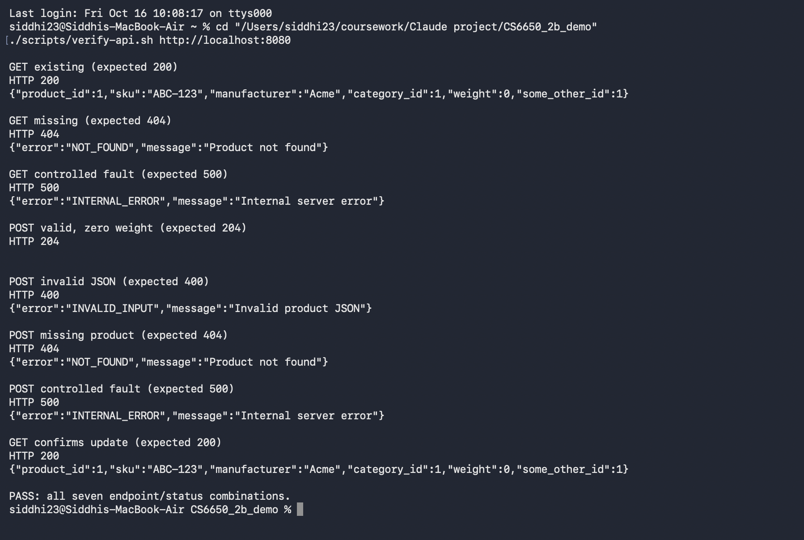

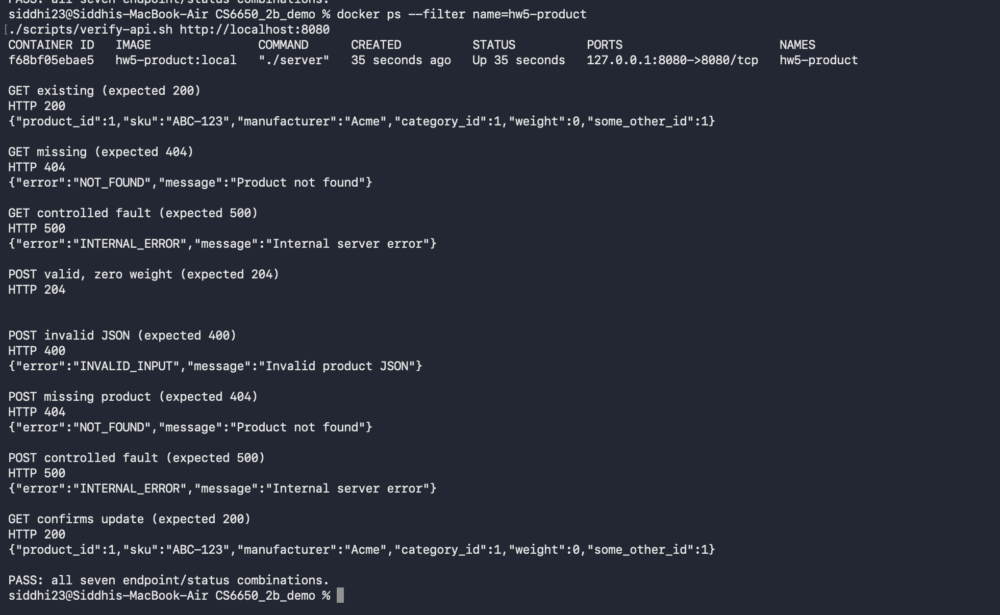

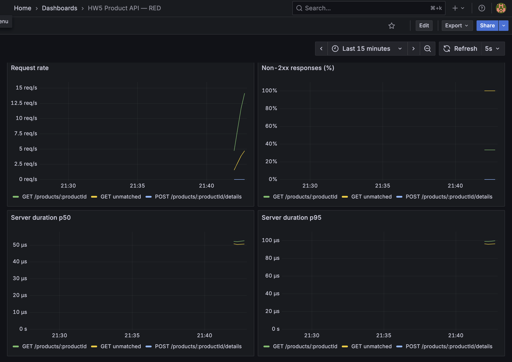

The Grafana screenshot is a setup check with deliberate errors, not Part IV
performance evidence or the final Part V idle-versus-loaded experiment.
A short Phase 1 JSON log excerpt is in evidence/logs/phase1-local-requests.jsonl;
the Part V excerpt from the measured run is linked in the local RED section.

Phase 2 deployment and load experiments are complete; results appear below.

## Deployment architecture preflight

Terraform builds linux/amd64 and the task runtime explicitly selects Linux X86_64.
The matching local image is built with:

```sh
docker build --platform linux/amd64 -t hw5-product:amd64 ./src
```

On Apple Silicon this image runs under emulation. Its timing is not performance
evidence. The local monitoring stack uses the host's native architecture.

Pre-deployment checks passed: expanded race tests and all seven HTTP response
cases. The amd64 image reported healthy with the command below; the temporary
container was removed afterward. No host port is needed because the check runs
inside the container.

```sh
docker run -d --name hw5-health --platform linux/amd64 \
  --health-cmd 'wget -qO- http://localhost:8080/health || exit 1' \
  --health-interval 5s hw5-product:amd64
# Allow the first health check to finish, then inspect:
docker inspect --format '{{.State.Health.Status}}' hw5-health
docker rm -f hw5-health
```

Terraform validation passed using AWS provider 6.7.0 and Docker provider 2.25.0.
The Docker provider's build platform setting is documented in its
[versioned resource documentation](https://github.com/kreuzwerker/terraform-provider-docker/blob/v2.25.0/docs/resources/image.md).
ECS health checks, deployment fault settings, content-based image tagging, and
push ordering are configured in Terraform.

## ECS deployment

Prerequisites: Terraform, Docker Desktop/Engine, AWS CLI, and valid course lab
credentials with their session token configured locally. Verify access with
`aws sts get-caller-identity`; ensure the lab session has enough time remaining.
Never commit credentials or Terraform state.

From the repository root:

```sh
# Docker Desktop's socket is not necessarily /var/run/docker.sock.
export DOCKER_HOST=$(docker context inspect --format '{{.Endpoints.docker.Host}}')
cd terraform
terraform init
# Replace with the public IPv4 address of your load generator.
terraform plan -var='allowed_cidrs=["YOUR_PUBLIC_IP/32"]' -out=hw5.tfplan
terraform apply hw5.tfplan
cd ..
./scripts/task-ip.sh
```

The service is cs6650-hw5-product in us-west-2. Wait until its task is RUNNING
and HEALTHY. The container checks /health every 30 seconds, with timeout 5,
three retries, and start period 10. Its runtime is Linux X86_64, 256 CPU units,
512 MiB memory; fault injection is explicitly false. The source-content hash
includes Dockerfile and module files, and is used for both the pushed image
and the task definition. ECS depends on the push finishing.

```sh
TASK_IP=$(./scripts/task-ip.sh)
curl "http://$TASK_IP:8080/health"
EXPECT_FAULTS=false ./scripts/verify-api.sh "http://$TASK_IP:8080"
```

The script defaults EXPECT_FAULTS to false, so fault headers must return normal
GET 200 and POST 204 responses on ECS. Both script modes were checked locally.
The public IP can change on redeployment; rerun task-ip.sh before tests. If the
load generator moves to another machine, allow that machine's IP in allowed_cidrs.
CloudWatch request logs are under /ecs/cs6650-hw5-product.

For local verification of 500 responses, explicitly enable app faults and set
EXPECT_FAULTS=true. Restore FAULT_INJECTION=false afterward.

Cleanup after collecting evidence:

```sh
cd terraform
terraform destroy -var='allowed_cidrs=["YOUR_PUBLIC_IP/32"]'
```

Measured performance and deployment evidence appear below.

## Load-test design and reproduction

The Go server remains the application. Python is used only for Locust, as
required. Experiments use Locust 2.46.6 (Python 3.13.15) in a native local Docker
container. The local experiment image hw5-locust:2.46.6 was tagged from a verified
installation; on another machine use `docker pull locustio/locust:2.46.6` followed
by `docker tag locustio/locust:2.46.6 hw5-locust:2.46.6`.

The comparison uses 50 users, spawn rate 10/s, one load-generator process,
90% GET and 10% valid POST, and a random 50–150 ms wait after each task.
Known IDs 1–1000 keep successful lookups and updates repeatable. The 20-second
warm-up includes spawning; statistics reset after warm-up, followed by 180
seconds of measurement. CPU samples identify the measurement interval.

```sh
TASK_IP=$(./scripts/task-ip.sh)
./scripts/start-locust.sh ProductHttpUser http-1 "http://$TASK_IP:8080" 50
# After saving results/screenshot, stop its dashboard container:
docker stop hw5-locust-http-1
./scripts/start-locust.sh ProductFastHttpUser fast-1 "http://$TASK_IP:8080" 50
```

Run names must be unique. The remaining four repetitions run sequentially with
scripts/run-comparison-repeats.py, alternating HttpUser and FastHttpUser. Do not
overlap comparison loads. The dashboard's Current RPS is a recent rolling rate;
summary tables use the full measurement-period Requests/s from exported CSV.

The separate stress workload removes all wait time and uses FastHttpUser with
one-minute stages at 50, 100, 200, 400, 700, and 1000 users, ramping at 50 users/s.
Stage timing includes ramp-up; analysis should compare sustained portions of
each stage. Its first 20 seconds are warm-up. Generator CPU samples and ECS
CPU/memory are needed before attributing a throughput limit to the server.

Locust's FastHttpUser uses geventhttpclient, while HttpUser uses requests. A
lower generator CPU cost can improve load-generation capacity; it does not
inherently make an individual server request faster. See the
[official Locust performance documentation](https://docs.locust.io/en/latest/increase-performance.html).

Locust failures indicate responses that violated the workload's expectations.
RED errors count every non-2xx response, including deliberate 400/404 cases.
The local demonstration workload is 88% valid GET, 10% valid POST, and 2%
intentional invalid/missing-product requests, checked with catch_response.
These workloads use statistical selection, so observed proportions vary.

## ECS client comparison results

Three alternating measured runs per client, 180 seconds per run after warm-up:

| Client | RPS median (range) | p50 ms median (range) | p95 ms median (range) | Generator CPU mean: median across runs |
|---|---|---|---|---|
| HttpUser | 241.8 (241.7–242.8) | 95 (95–96) | 150 (150–150) | 30.8% |
| FastHttpUser | 244.8 (244.5–245.1) | 93 (93–93) | 150 (150–150) | 16.8% |

All six runs had zero failures. Generator CPU is process CPU measured with
psutil: 100% corresponds to one CPU core, not the whole laptop. Per-run CPU
means/maxima and latency/throughput are in results/locust/comparison-runs.csv.
Raw CSVs, timestamps, warm-up settings, and HTML reports are preserved there.
The median throughput difference is about 1.2%, while p95 is unchanged. These
runs are below saturation, with think time and network latency contributing to
the request cycle; lower client CPU overhead therefore need not create a large
throughput improvement. Small latency differences do not establish a causal
server improvement. This is one environment, not a general performance ratio.

CloudWatch CPU and memory exports are in results/cloudwatch, with one-minute
resolution. Use run timestamps to distinguish individual comparisons and idle
gaps; the dashboard screenshot also includes startup/idle time.

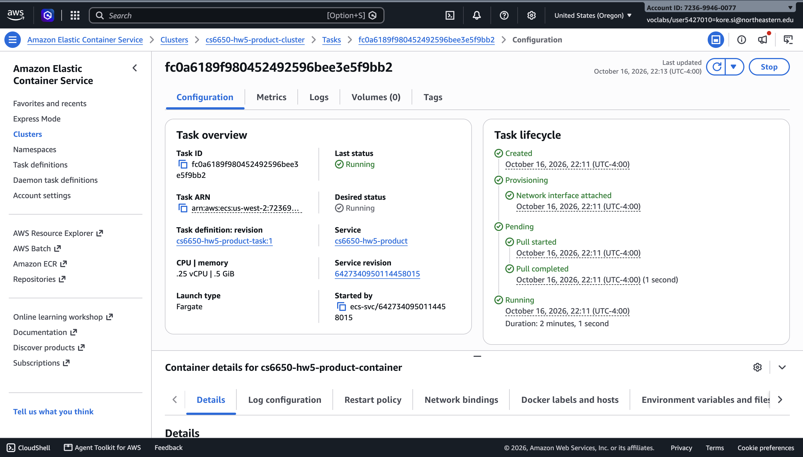

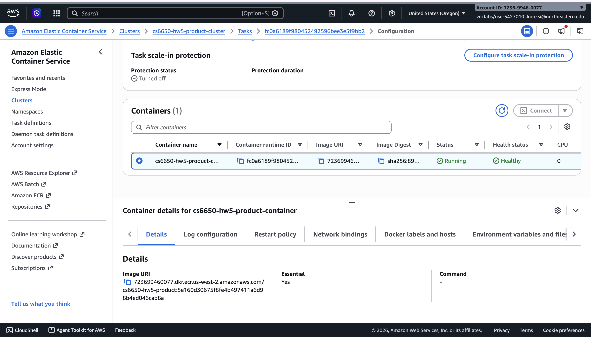

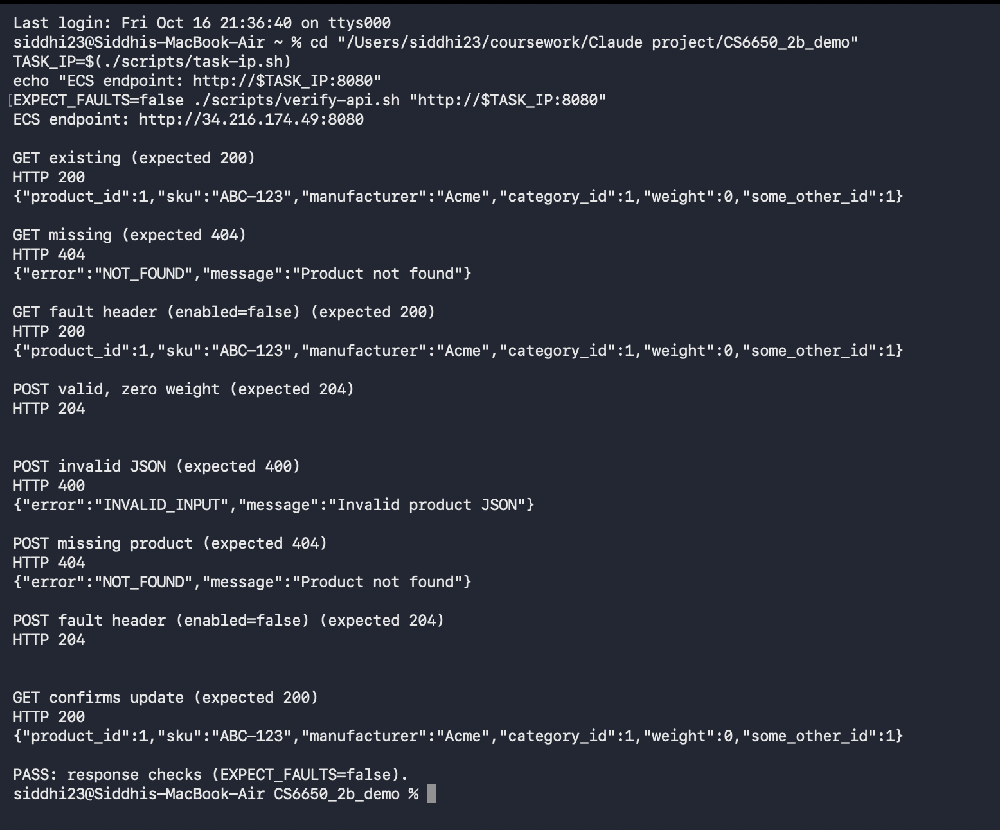

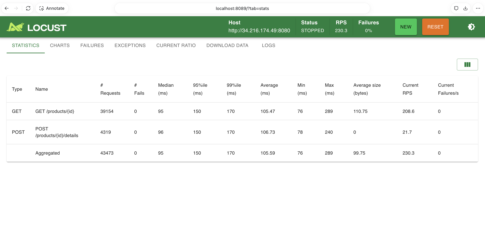

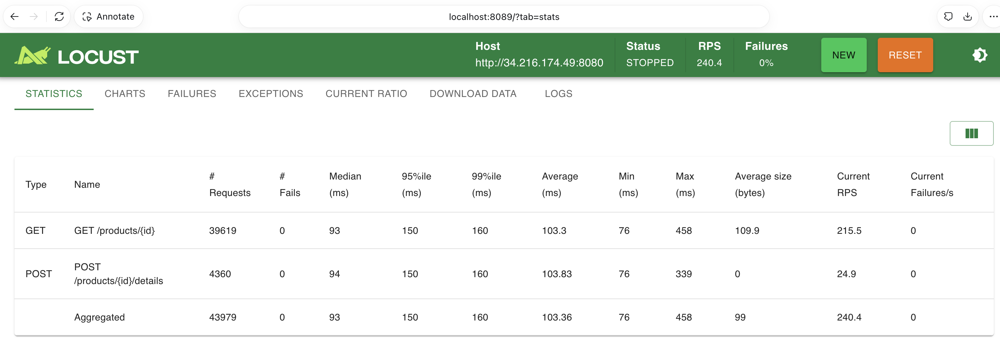

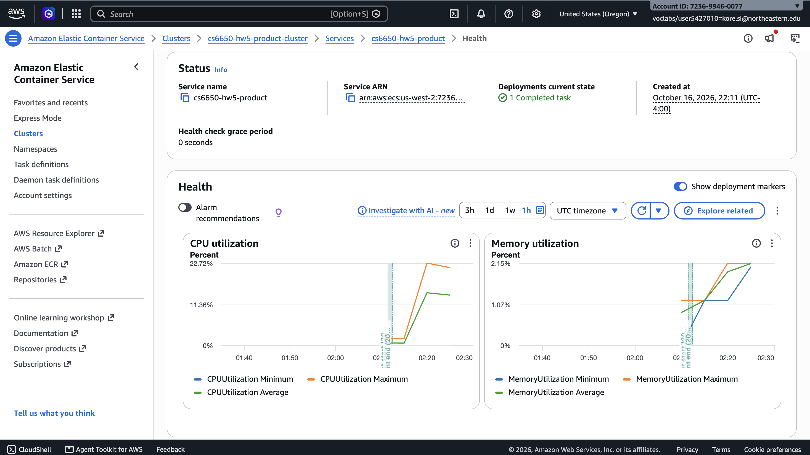

## ECS stress results

FastHttpUser, zero wait, one process; six one-minute stages. The table averages
rolling RPS and takes the median rolling percentiles over each stage's sustained
portion (20 seconds after the level starts through two seconds before it ends).
These are not full-stage percentile distributions. Values come from exported
history and CPU samples, summarized in results/locust/stress-stages.csv.

| Users | Mean rolling RPS | Median rolling p50 ms | Median rolling p95 ms | Generator CPU mean / max |
|---|---|---|---|---|
| 50 | 441 | 96 | 140 | 16.5% / 21.0% |
| 100 | 948 | 99 | 140 | 25.5% / 28.9% |
| 200 | 1807 | 99 | 140 | 25.5% / 28.0% |
| 400 | 2838 | 115 | 200 | 37.7% / 44.6% |
| 700 | 3316 | 190 | 330 | 45.8% / 58.3% |
| 1000 | 3394 | 270 | 490 | 47.3% / 59.7% |

The observed knee begins around 400–700 users: adding users yields diminishing
throughput gains and higher tail latency. From 700 to 1000 users throughput
increases only about 2%, while median rolling p95 rises from 330 to 490 ms.
The measured run completed 756,499 requests with zero failures; its aggregate
p95 was 380 ms. That aggregate mixes several load levels and is distinct from
the final-stage rolling p95.

CloudWatch reports ECS CPU near 100% during the higher-load stages; memory
peaked around 13.1% of 512 MiB. Generator process CPU stayed below 60% of a core.
Together these observations support server CPU saturation rather than a
load-generator CPU ceiling. They do not isolate CPU time spent on routing,
JSON, metrics, locks, or per-request logging; profiling would be needed for that.
The single task has only 0.25 vCPU. The test does not establish a universal API
capacity or a hard failure threshold, and the one-minute stages are short.

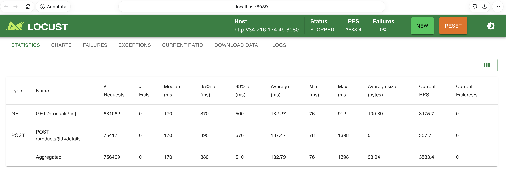

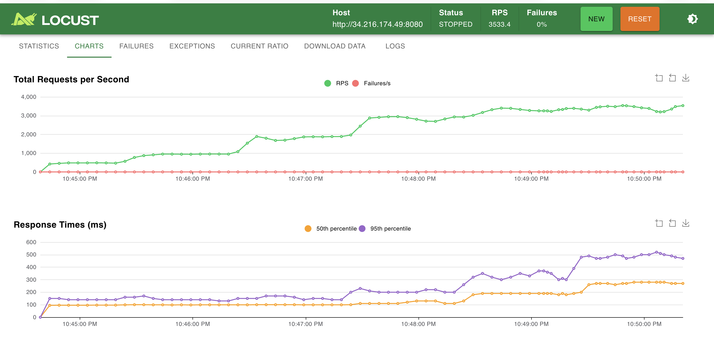

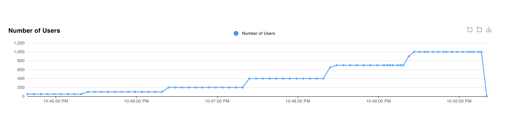

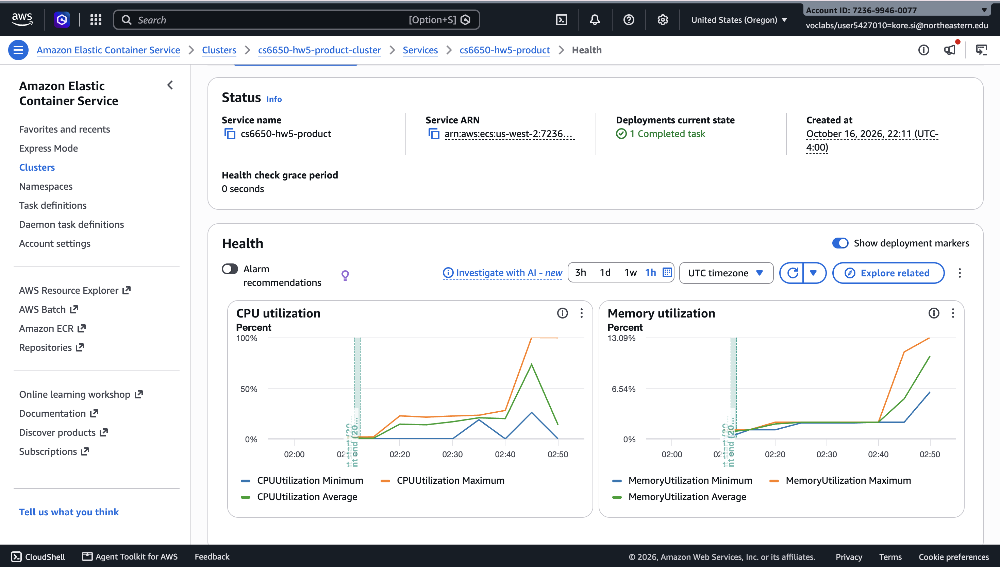

## Local RED observability experiment

The local app, Prometheus, and Grafana ran under Docker Compose with fault
injection disabled. A 90-second idle baseline began at 02:58:38 UTC on
October 17, 2026 (10:58:38 PM EDT on October 16). Local FastHttpUser traffic
began at 03:00:08 UTC (11:00:08 PM EDT), with 20 seconds of warm-up and 180
seconds of measurement, 50 users, spawn rate 10/s, and 50–150 ms think time.
The workload intentionally selected 88% valid GET, 10% valid POST, 1% missing
GET (404), and 1% invalid POST (400). These are local measurements, distinct
from the ECS tests above.

Locust recorded 88,553 measured requests and zero unexpected failures.
The entire local load window, including warm-up, produced 97,160 business
request logs: 85,468 responses with 200, 9,777 with 204, 966 with 400, and
949 with 404. That is 1.97% non-2xx. Expected 400/404 responses pass Locust's
expectation checks while still contributing to Prometheus RED errors.
The counts differ because Locust resets its statistics after warm-up, while
the saved log-window totals include warm-up.

The dashboard shows an idle baseline, loaded traffic, and the return toward
idle. Error percentages are calculated separately for each endpoint: roughly
1/89 of GETs and 1/11 of POSTs are deliberately invalid, explaining about 1%
GET errors versus 9% POST errors. The overall error share remains about 2%.
A one-minute rate window smooths the start and end of traffic. Idle latency
has no observations rather than meaningful zero latency. Histogram quantiles
are bucket-based estimates; most local requests land in the first 0.1 ms
bucket, so displayed p50/p95 are approximate, not exact microsecond timings.

I would use the dashboard to spot changes in request rate, error share, and
tail latency over time. I would use the JSON logs to inspect specific requests
and their statuses and durations during the affected interval.

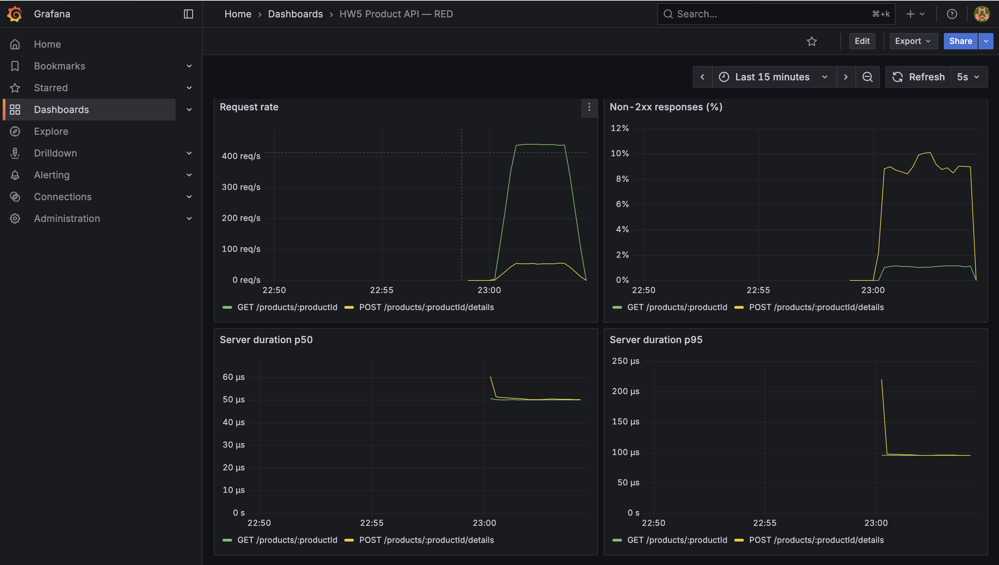

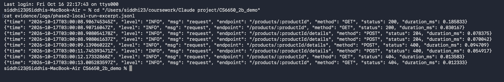

The machine-readable excerpt is evidence/logs/phase2-local-run-excerpt.jsonl.
Its 03:00 UTC timestamps match 11:00 PM EDT on the dashboard. The run settings,
time window, and log totals are in results/locust/local-red_metadata.json.
Reproduce by running `python3 scripts/prepare-local-observability.py` with the
Compose stack up and port 8089 free; it records an idle baseline before load.

## Phase 2 completion and cleanup

All six comparison runs, the ECS stress run, and the local RED run completed.
Their CSVs, analysis, matching logs, and screenshots are saved in this repository.
Terraform cleanup removed all eight managed deployment resources. The Terraform
state is empty and the ECS cluster is INACTIVE with zero running tasks. The old
public API address is no longer a live endpoint; redeploy and rediscover the task
IP for a live demo. The local Compose monitoring stack remains available.

Authentication clarification, final submission review, and interview preparation
remain separate follow-up work.
