# HW6 screenshot evidence

Thirteen unique screenshots supplied by the user. Duplicate attachments are included once. All AWS time windows below are UTC on October 23, 2026. These figures supplement the measured findings; the gallery is separate from the 1–2 page report.

## Figure 1. Local search instrumentation

Local smoke test; this is not an AWS load-test result.

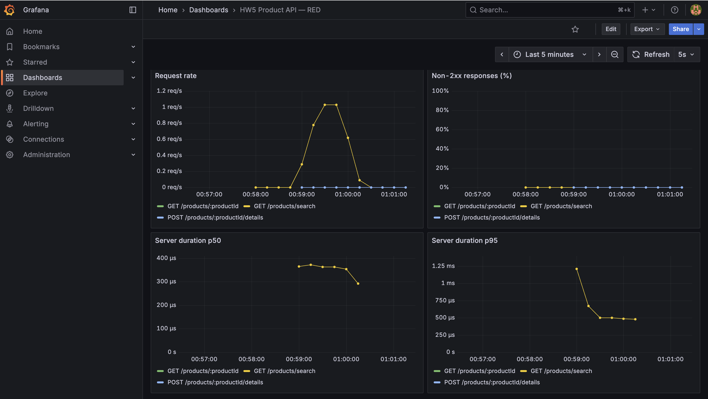

## Figure 2. Five-user baseline

October 23, 05:17–05:22 UTC. Search traffic, errors and server duration alongside ECS CPU and memory.

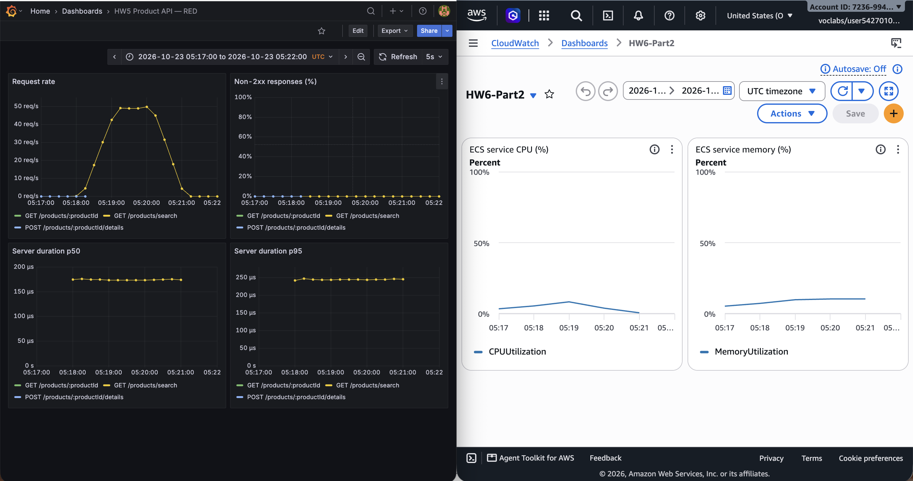

## Figure 3. Twenty-user required test

October 23, 05:31–05:37 UTC. This load did not saturate CPU.

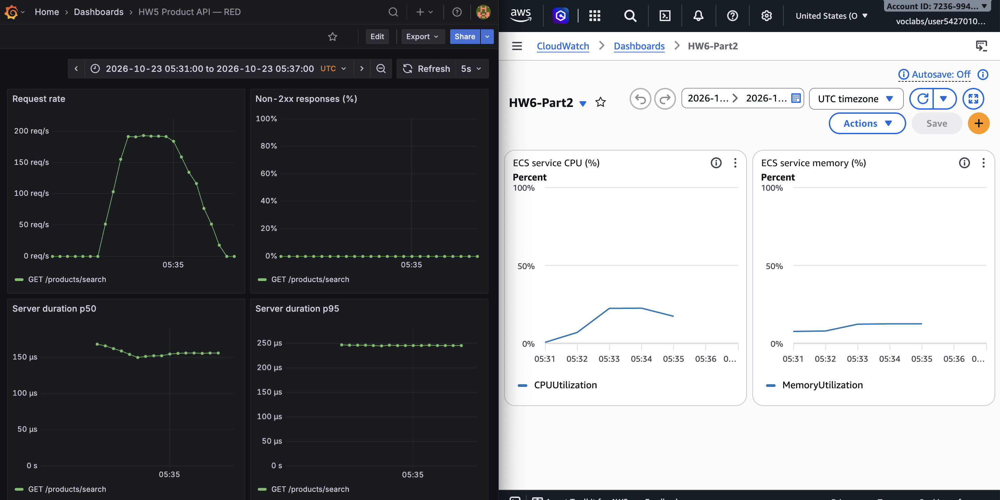

## Figure 4. Spike to 100 users

October 23, 05:38–05:46 UTC. CPU pressure increased without search failures.

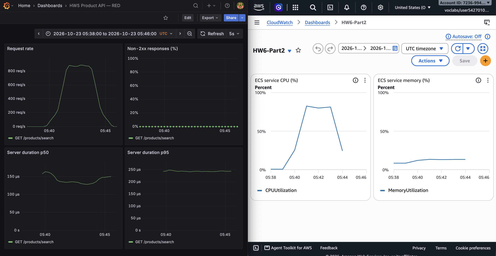

## Figure 5. Single-task saturation at 200 users

October 23, 05:47–05:53 UTC. CPU reached approximately 100%; memory remained well below its limit.

## Figure 6. ALB core comparison: CPU and tasks

October 23, 06:03–06:09 UTC. Two healthy targets served the matching 200-user workload.

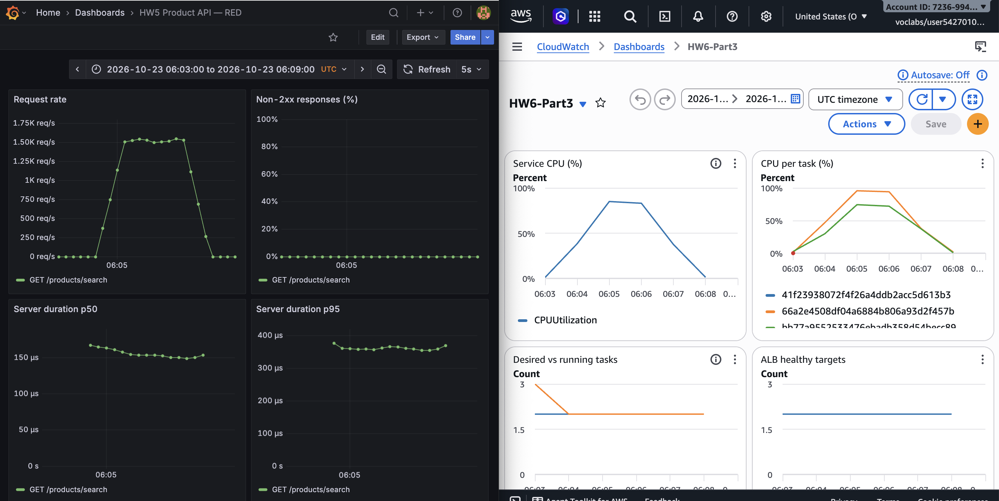

## Figure 7. ALB core comparison: requests and latency

October 23, 06:03–06:09 UTC. ALB response time has a different measurement scope from Grafana middleware duration.

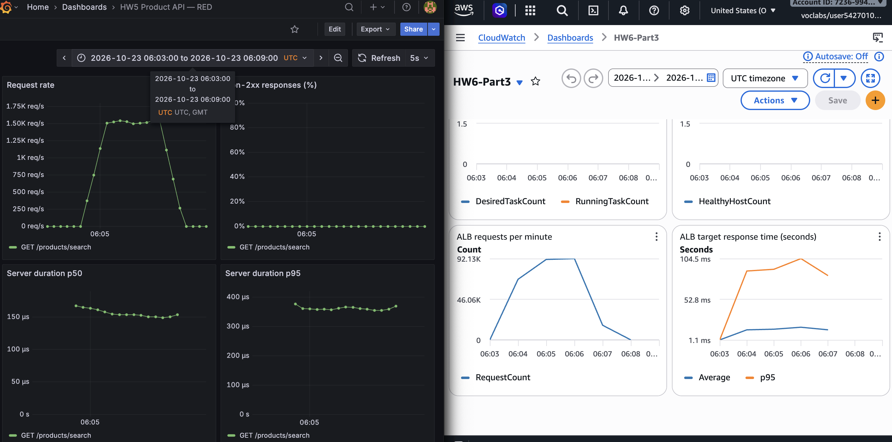

## Figure 8. Scale-out: CPU and capacity

October 23, 06:14–06:27 UTC. Desired and running capacity increased from two to three; service CPU decreased.

## Figure 9. Scale-out: ALB latency

October 23, 06:14–06:27 UTC. ALB p95 decreased after the third target became healthy.

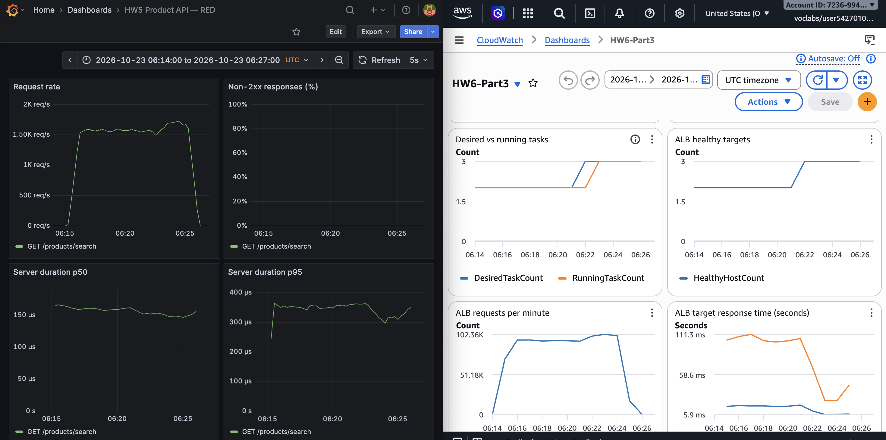

## Figure 10. Task-stop resilience: CPU and capacity

October 23, 06:29–06:38 UTC. Running-task dips reflect the injected stops. The dashboard healthy-target statistic misses brief dips captured by the separate observer.

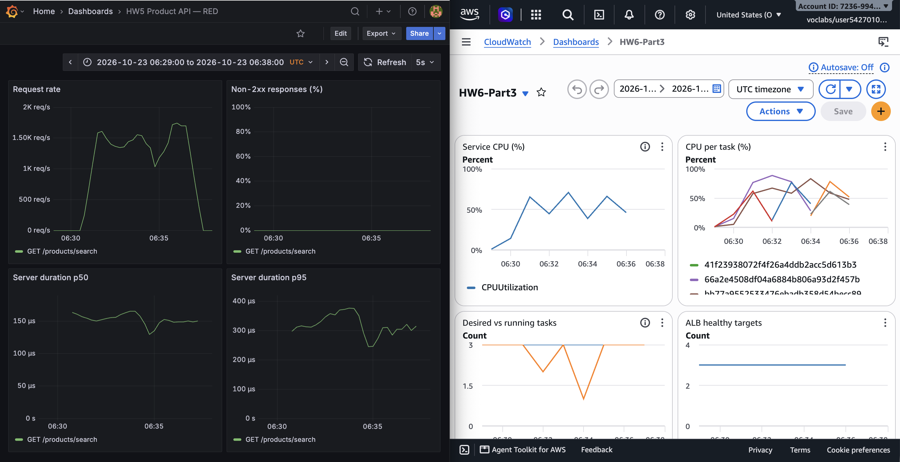

## Figure 11. Task-stop resilience: ALB metrics

October 23, 06:29–06:38 UTC. Search requests continued during replacement; use event logs for exact injection and recovery bounds.

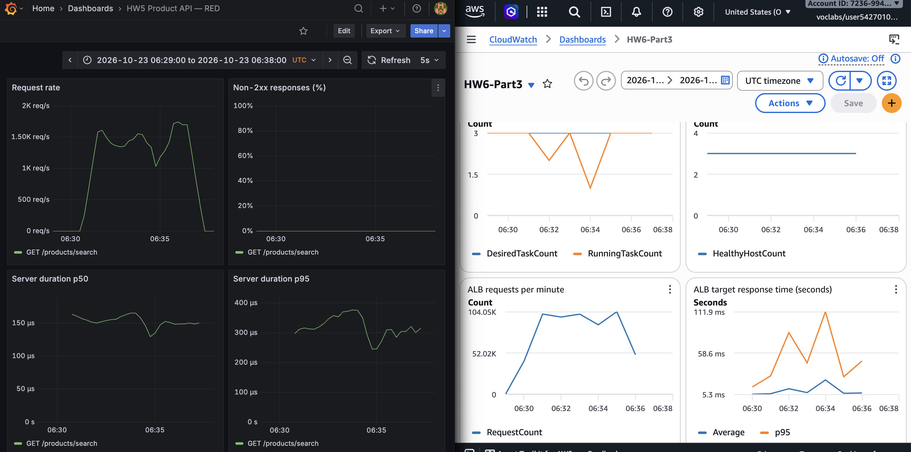

## Figure 12. Health-check failure and recovery

October 23, 06:39–06:47 UTC. Healthy targets fell to zero and recovered. Yellow GET unmatched errors are intentional bad-health-path responses; search errors remained zero.

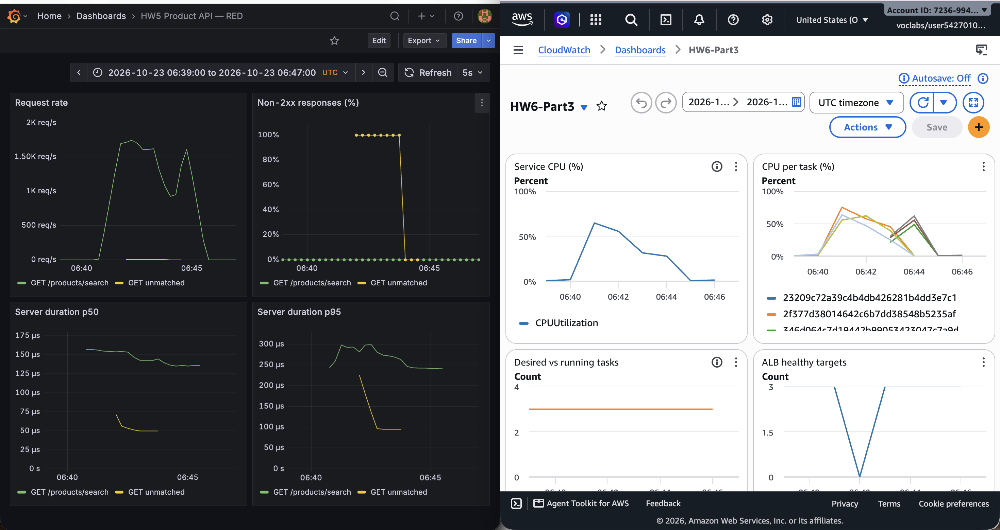

## Figure 13. Health-check failure: ALB metrics

October 23, 06:39–06:47 UTC. Search traffic continued during the all-unhealthy interval; probe logs provide the direct fail-open evidence.

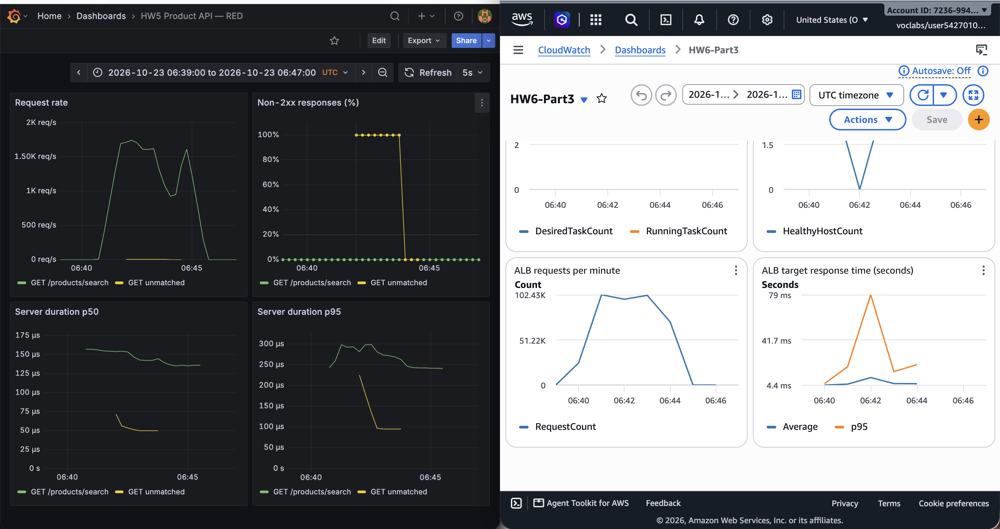
