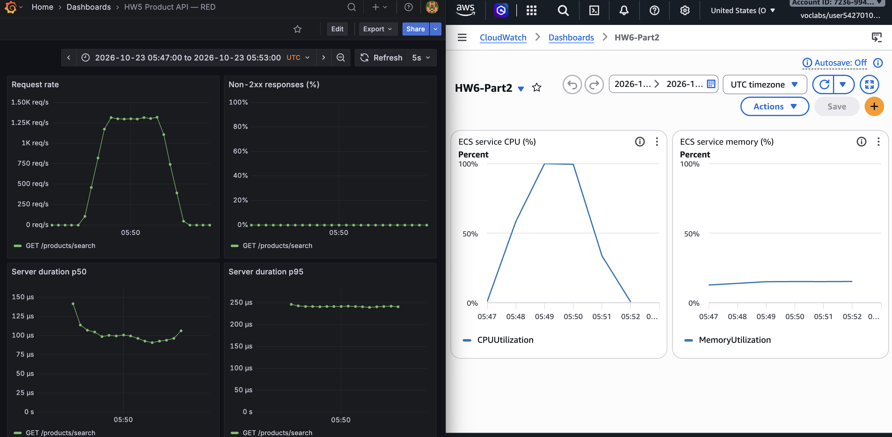
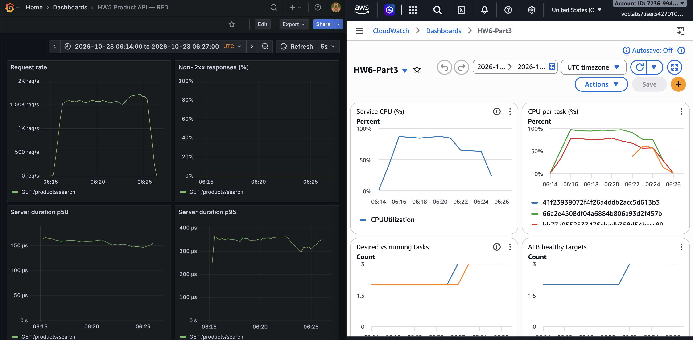

# HW6 | Product Search and Elastic Scaling

Siddhi Kore | CS6650 - Parts II and III | October 23, 2026 | Times: UTC

## Part II: workload and single-task capacity

The Go service initializes 100,000 products in sync.Map. Searches check exactly 100 products, match names/categories case-insensitively and return at most 20 matches. Logs and race-enabled tests verify the bound and existing GET/POST behavior. Unordered iteration can change repeated results.

Each Fargate task used 256 CPU units and 512 MB. Laptop-hosted Locust FastHttpUser used zero wait and the same queries throughout. UTC windows, workload hashes and client histories were saved. Prometheus scraped tasks individually; RED and CloudWatch windows were aligned.

| Deployment / users / duration | Requests | RPS | Client p95 | CPU* |

|---|---|---|---|---|

| Single task / 5 / 2 min | 5,909 | 49.4 | 150 ms | 8.3% |

| Single task / 20 / 3 min | 33,327 | 175.4 | 160 ms | 22.5% |

| Single task / 200 / 3 min | 229,842 | 1,278 | 300 ms | 99.9% |

| ALB, 2 tasks / 200 / 3 min | 268,482 | 1,492 | 210 ms | 84.9% |

| ALB, 2 to 3 / 200 / 10 min | 957,475 | 1,596 | 210 ms | 84-87 to 63-64% |

*CPU is published minute-average utilization: peak/full-load values for short tests and before/after ranges for the long test. RPS and client p95 are whole-run statistics. All five runs had zero request failures. The configured 20-user test overran by about 10 seconds; its actual UTC duration was retained.

**Low CPU at 20 users:** with zero wait, users/RPS implies 101 ms per request at five users and 114 ms at twenty. Client/network delay limited offered load, consistent with 22.5% CPU despite exactly 100 checks (local checked=100 logs; TestSearchContractAndBound). Therefore 200 users became the breaking-point test, reused for the Part III core comparison.

**CPU limited capacity:** at 200 users CPU averaged 99.4-99.9%, memory stayed near 15-16% and client p95 doubled. Middleware p95 stayed near 0.25 ms; pre-handler queueing/scheduling or network delay are possible, unproven causes of the discrepancy. Raising CPU to 512 units may help capacity, but was not tested and cannot remove network RTT.

**Measurement-method limit:** a separate ten-request sequential laptop/AWS check had 200 ms median and search_time near 0.15-0.21 ms. Its client and connection-reuse settings were not preserved. It is not comparable to the five-user FastHttpUser p95; a same-method AWS single-user 20 ms target was not verified.

## Part III: balancing, autoscaling and resilience

The unchanged application image ran behind an ALB using IP targets on port 8080, /health checks every 30 seconds, healthy threshold 2, and a 60-second ECS health grace period. CPU target tracking used 70%, minimum 2 / maximum 4 tasks and 300-second scale-in/out cooldowns. Container Insights supplied per-task CPU. The matching 200-user, three-minute ALB test improved throughput 16.8% and client p95 30% versus one task; sampled per-task traffic was balanced at roughly 762-765 RPS.

**Actual scale-out:** the 10-minute test began at 06:15:09.938. The CPU alarm increased desired capacity from 2 to 3 at 06:21:40.698, about 6m31s later. Three running, healthy tasks were first observed at 06:22:26.471 (a sampled transition bound). CPU fell from 84-87% to 63-64%; recent client p95 improved from roughly 220 to 175-180 ms, and ALB p95 from roughly 100-111 to 24 ms. No requests failed. A later scale-in to two tasks occurred at 07:00:35, about 16 minutes after load ended: the low alarm required 15 one-minute periods, so cooldown alone did not determine timing.

**Failure tests:** stopping one task, then two, during a separate 200-user run produced zero failures across 582,363 searches. Sampled healthy-target recovery took about 82 and 74 seconds. Desired capacity stayed three: ECS replacement maintained capacity, distinct from autoscaling changing it. During the health-path experiment, all three targets were unhealthy while three successive ALB search probes still returned 200, consistent with fail-open. The four-minute run had 397,996 successful searches. ECS replaced unhealthy tasks; /health was restored and verified. Yellow GET unmatched errors in that screenshot are intentional bad-health-path responses, not search failures.

**Exploration and interpretation:** a 20-to-100-to-20 spike completed 181,945 requests without failures and reached about 80-82% CPU. A 20/50/100/200-user ramp completed 185,763 requests without failures. Separate short trials changed CPU targets to 50%/90%, minimum to four, maximum to two and each cooldown to 30 seconds, one setting at a time. These windows and carried task state do not establish controlled steady-state latency improvements; short cooldowns do not bypass alarm evaluation. Lower targets/minimum headroom trade cost for earlier capacity; low maximum capacity limits growth.

**Trigger choice and trade-offs:** CPU was a clearer trigger than this middleware-duration signal because it exposed saturation while handler p95 stayed low. ALB p95 was already 104 ms in the 06:15 bucket (CPU average 41%); CPU average first exceeded 70% at 06:16 (87%). Thus ALB latency showed pressure one minute earlier at this resolution, but sub-minute ordering and an untested latency policy trigger time are unknown. Requests-in-flight was not instrumented, so its trigger timing is unknown. Horizontal scaling adds redundancy but duplicates the catalog, incurs ALB/minimum-task costs and requires startup and monitoring coordination. Vertical scaling is simpler but retains a larger single-task failure impact. The observed delay favors spare capacity for sudden spikes; gradual growth gives the controller time to react.

Evidence: CSV/HTML load results and UTC metric/event exports are saved with the repository; evidence/hw6/SCREENSHOTS.md contains all 13 captioned captures. Repository: github.com/SidK2301/CS6650_2b_demo.
